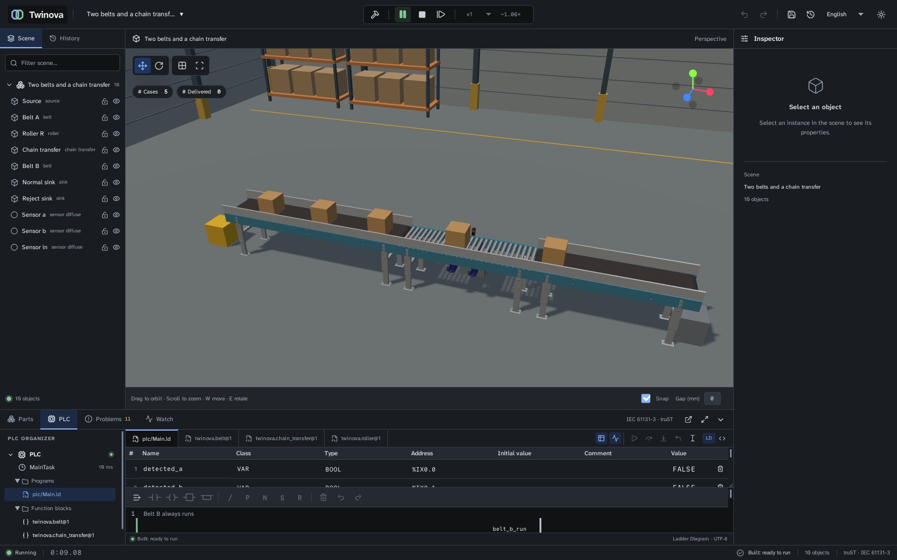
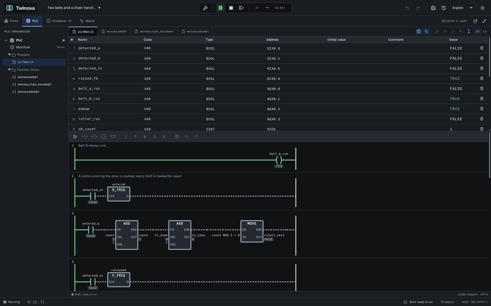

<div align="center">


# Twinova

**Open-source 3D factory simulation and virtual commissioning.**

Build the line. Run deterministic material flow. Test PLC logic before the hardware exists.

[](https://github.com/chetto1983/Twinova/actions/workflows/ci.yml)
[](#license)
[](app/src-tauri/rust-toolchain.toml)
[](https://v2.tauri.app/)

[What is Twinova?](#what-is-twinova) · [What it does today](#what-it-does-today) · [Architecture](#architecture) · [Quick Start](#quick-start) · [Documentation](#documentation) · [Development](#development)

</div>

---

## What is Twinova?

Twinova is an open-source 3D factory simulator and virtual-commissioning tool for automation engineers. You lay out a production line from reusable components, run its material flow deterministically, and program its PLC; the goal is to connect a real or emulated PLC to it before the machine exists.

The project is **headless first**: the simulation engine is a library, the desktop app one client of it and an MCP server for coding agents another. PLC-in-the-loop, repeatable runs, open component models and open industrial connectivity are product foundations rather than paid extensions.

> **Status: [v0.4.0](https://github.com/chetto1983/Twinova/releases/tag/v0.4.0).** Lines run in the app against its built-in PLC (truST's IEC 61131-3 runtime). Connecting an external PLC (PLCSIM Advanced in lockstep, S7, Modbus TCP, OPC UA) is [Roadmap](ROADMAP.md) phase 5; robots, axes and CAD import come after it.

<div align="center">



<sub>A line from the component library running in 3D, its PLC program below.</sub>



<sub>The same program in Ladder, online: values from the running PLC and the power flow its scan computed.</sub>

</div>

## What it does today

- **Lines from a component library** after [Open Industry Project](https://github.com/Open-Industry-Project/Open-Industry-Project) (MIT): belt and roller conveyors, straight and curved, a chain transfer, a stopper, a pusher, a turntable, a source of products with size, colour and code, a sink, and diffuse, through-beam, colour, laser and barcode sensors. The conveyors' and devices' logic is an IEC 61131-3 function block you can edit.
- **A scene editor:** place from a catalogue or drag into the 3D view, move and turn with a gizmo, snap conveyors end to end, edit parameters, signals and connections in the inspector, undo and redo.
- **Physics you can replay:** Rapier rigid-body physics with enhanced determinism, stepped every millisecond in lockstep with the components' logic and the PLC scan, on virtual time. A run is replayed exactly, the same on Linux and Windows; save a state and come back to it.
- **The PLC inside the app:** Structured Text and Ladder (as CODESYS's LD2), built to truST's bytecode runtime with no external compiler. The scan time comes from the program's IEC task.
- **A PLC IDE's online tools:** values beside the code and on the Ladder drawing, write and force, breakpoints that hold the line as an S7-1500's HOLD with stepping and conditions, completion with call templates, go to definition, rename, Auto Declare, PLCopen `<LD>` import and export, and the PLC pane in a window of its own. The `.st` files can also be edited in VS Code while the line runs.
- **Time under control:** ×0.25 to ×10 the wall clock or as fast as possible, pause, a single scan, reset, and the lag behind real time shown.
- **Coding agents:** `twinova-agent` serves Twinova over the Model Context Protocol. With the app open it drives the window you are looking at, every action of it, and takes screenshots; without it, it runs a headless session that opens, edits, builds and runs a project on virtual time. `twinova-agent setup` registers it with Claude Code and Claude Desktop.
- **Desktop basics:** English and Italian, light and dark themes, an MSI for Windows and a deb and an AppImage for Linux.

## At a glance

| | |
|---|---|
| **Stage** | Early releases, v0.4.0; external PLCs not connected yet |
| **Desktop** | Tauri 2, Svelte 5, TypeScript, Three.js, Monaco |
| **Engine** | Rust 1.99, a 1 ms lockstep on integer virtual time, Rapier 0.36 with enhanced determinism |
| **PLC logic** | IEC 61131-3 Structured Text and Ladder, on the pinned truST runtime |
| **Languages** | English and Italian |
| **Targets** | Windows and Linux desktop; the engine is a library, also served over MCP |
| **Quality gates** | Rust fmt/clippy/tests, frontend static checks, ≥85 % coverage, mutation testing with no survivor, real-app E2E on Linux and Windows, a 600-line cap per file |
| **Release state** | [v0.4.0](https://github.com/chetto1983/Twinova/releases/tag/v0.4.0) published; the installers are not signed yet |

## Architecture

```text
Desktop shell       Tauri 2 · Svelte 5 · Aura design tokens · English/Italian messages
PLC workspace       Structured Text (Monaco) and Ladder editors · truST analysis · online monitoring · breakpoints
PLC runtime         truST bytecode VM · the line program at its IEC task's period · Ladder lowered to ST
Component logic     each component's IEC 61131-3 function block, run every millisecond in a field runtime
Engine              1 ms lockstep on virtual time: physics, sensors, component logic, PLC scan · replay by inputs
Physics             Rapier rigid bodies with enhanced determinism · OIP's conveyor surfaces, devices and products
Visualization       Three.js · engine snapshots drive rendering, never simulation time
Agents              twinova-agent: MCP on the open app's window, or a headless session (stdio or HTTP)
Packaging           Windows MSI · Linux deb/AppImage
```

Rust owns the simulation state and its time; the webview receives snapshots and renders them, so a slow frame never changes a run.

## Product direction

Twinova is working toward:

- one open component model for geometry, joints, behaviors, properties, and typed signals;
- a deterministic hybrid engine combining discrete events, analytic motion, and fixed-step physics only where needed;
- an external PLC in the loop: PLCSIM Advanced in lockstep for repeatable tests, and free-running S7, OPC UA,
  Modbus, MQTT, ADS and other open connectivity;
- axes, servos and robots, and CAD import;
- a reusable component catalog and a headless automation/test surface.

These are planned capabilities, not claims about the current release. Milestones, phase status, and acceptance criteria live in the [Roadmap](ROADMAP.md).

## Quick Start

**Install:** download the MSI (Windows), the deb or the AppImage (Linux) from the [v0.4.0 release](https://github.com/chetto1983/Twinova/releases/tag/v0.4.0). The installers are not signed yet, so Windows SmartScreen asks for confirmation on the first start (More info, then Run anyway).

The app opens on a bundled demo, one belt; the project menu lists the other example lines under **Examples**. A project folder also opens from the command line (`twinova <folder>`). The [guide](docs/guide.md) goes from there: the scene, the PLC pane, the online tools, and connecting an agent.

**Build from source:** you need Node.js **22.23.4** (pinned in `.node-version`), Rust **1.99.0** (pinned by the app), and the [Tauri 2 system prerequisites](https://v2.tauri.app/start/prerequisites/) for your operating system.

```sh
git clone https://github.com/chetto1983/Twinova.git
cd Twinova/app
npm install
npm run tauri dev
```

Linux requires WebKitGTK 4.1 and the remaining Tauri packages. No external IEC 61131-3 toolchain is needed.

## Documentation

| Document | Purpose |
|---|---|
| [Guide](docs/guide.md) | Install, the example lines, the scene, the PLC pane, the online tools, connecting an agent |
| [Roadmap](ROADMAP.md) | Milestones, phases, acceptance criteria, and current status |
| [Research index](docs/research/00-indice.md) | Clean-room product, engine, PLC, ecosystem, and component-catalog research (Italian) |
| [Changelog](CHANGELOG.md) | Shipped behavior and future release text |
| [ST in VS Code](docs/vscode.md) | Editing a project's Structured Text in VS Code while the line runs |
| [Engineering guide](CLAUDE.md) | Architecture rules, pinned dependencies, validation gates, and commit discipline |
| [Designs and plans](docs/superpowers/) | Approved specifications, implementation plans, and verification records |

The research compares commercial and open-source simulators, simulation-engine designs, PLC synchronization, Rust building blocks, IEC runtimes, and catalog formats. Claims cite their public sources; commercial descriptions are paraphrased clean-room. Twinova is not affiliated with the vendors discussed there.

## Development

Frontend checks run from `app/`:

```sh
npm run check
npm run lint
npm run format:check
npm run check:i18n
npm run coverage
npm run build
```

Rust checks run from `app/src-tauri/`:

```sh
cargo fmt --check
cargo clippy --all-targets -- -D warnings
cargo test
```

The real application is exercised through `tauri-driver` on Windows and Linux. Git hooks install with `cd app && npm run hooks`; the complete post-edit gate, mutation commands, E2E flow, and soak checks are in the [Engineering guide](CLAUDE.md).

CI builds an unsigned MSI for Windows and deb/AppImage packages for Linux on pushes to `main`. Pushing a tag `vX.Y.Z`, or running the Release workflow with one, publishes a GitHub release whose text is that version's section of the [Changelog](CHANGELOG.md).

## License

Licensed under either the [Apache License, Version 2.0](LICENSE-APACHE) or the [MIT License](LICENSE-MIT), at your option.
