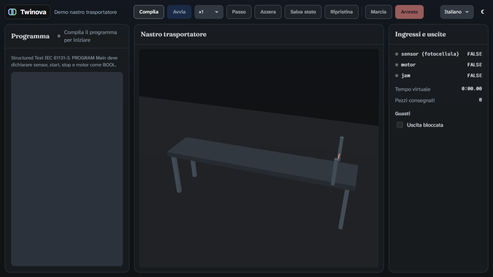

<div align="center">


# Twinova

**Open-source 3D factory simulation and virtual commissioning.**

Build the line. Run deterministic material flow. Test PLC logic before the hardware exists.

[](https://github.com/chetto1983/Twinova/actions/workflows/ci.yml)
[](#license)
[](app/src-tauri/rust-toolchain.toml)
[](https://v2.tauri.app/)

[What is Twinova?](#what-is-twinova) · [Current prototype](#current-prototype) · [Architecture](#architecture) · [Quick Start](#quick-start) · [Documentation](#documentation) · [Development](#development)

</div>

---

## What is Twinova?

Twinova is an open-source 3D factory simulator and virtual-commissioning tool for automation engineers. The long-term goal is to lay out a production line from reusable components, run its material flow deterministically, and connect a real or emulated PLC before the machine exists.

The project is **headless first**: the simulation engine is designed as a library or service, while the desktop editor is one client. PLC-in-the-loop, repeatable runs, open component models, and open industrial connectivity are product foundations rather than paid extensions.

> **Status: early prototype.** The repository contains the research and engineering foundation plus a runnable first desktop slice. The broader component library, physics integration, PLC drivers, and lockstep commissioning workflow remain on the [Roadmap](ROADMAP.md).

<div align="center">



<sub>The current desktop shell: IEC 61131-3 Structured Text, a 3D conveyor scene, deterministic controls, and live I/O.</sub>

</div>

## Current prototype

The runnable application in `app/` is a Tauri 2 desktop app built around one analytically simulated belt conveyor:

- **Structured Text in the app** — edit and build an IEC 61131-3 program without installing a PLC compiler. The program runs on truST's bytecode VM.
- **Deterministic discrete-event engine** — nexosim runs on one thread with integer nanosecond time; belt motion is computed in closed form, so sensor edges are not tied to a render frame.
- **PLC scan semantics** — the scan period comes from the IEC task configuration instead of an unrelated UI timer.
- **Controllable time** — run from ×0.25 to ×10 wall-clock speed, run unpaced, pause, step one scan, and save or restore simulation state.
- **3D operator view** — Three.js renders the conveyor and parts while the Rust engine remains authoritative.
- **Operator-facing diagnostics** — I/O values, virtual time, delivered-part count, blocked-outlet fault injection, and visible real-time lag.
- **Desktop basics** — English and Italian interfaces, light and dark themes, Windows MSI plus Linux deb/AppImage build pipelines.

## At a glance

| | |
|---|---|
| **Stage** | Early prototype; first vertical slice is runnable |
| **Desktop** | Tauri 2 with Svelte 5, TypeScript, and Three.js |
| **Engine** | Rust 1.99, deterministic discrete-event core with analytic conveyor motion |
| **PLC logic** | IEC 61131-3 Structured Text on the pinned truST runtime |
| **Languages** | English and Italian |
| **Targets** | Windows and Linux desktop bundles; headless engine is the architectural direction |
| **Quality gates** | Rust fmt/clippy/tests, frontend static checks, ≥85% coverage, mutation tests, real-app E2E, file-size cap |
| **Release state** | CI builds unsigned installers; no public release is published yet |

## Architecture

```text
Desktop shell       Tauri 2 · Svelte 5 · Aura design tokens · English/Italian messages
PLC workspace       Structured Text editor · truST syntax/build pipeline · bytecode VM
Simulation API      Tauri commands and events · immutable snapshots · save/restore state
Engine              nexosim discrete-event core · integer nanosecond time · IEC scan tasks
Material flow       analytic belt motion · exact sensor crossings · jam and outlet behavior
Visualization       Three.js scene · engine snapshots drive rendering, never simulation time
Packaging           Windows MSI · Linux deb/AppImage · headless-first library boundary
```

The present slice deliberately keeps the engine and view separate: Rust owns simulation state and timing; the webview receives snapshots and renders them. Planned fixed-step physics will only cover interactions that cannot be solved analytically.

## Product direction

Twinova is working toward:

- one open component model for geometry, joints, behaviors, properties, and typed signals;
- a deterministic hybrid engine combining discrete events, analytic motion, and fixed-step physics only where needed;
- free-running and PLC-synchronized lockstep modes, including repeatable PLCSIM Advanced tests;
- S7, OPC UA, Modbus, MQTT, ADS, and other open connectivity;
- a reusable component catalog and a headless automation/test surface.

These are planned capabilities, not claims about the current prototype. Milestones, phase status, and acceptance criteria live in the [Roadmap](ROADMAP.md).

## Quick Start

You need Node.js **22.23.4** (pinned in `.node-version`), Rust **1.99.0** (pinned by the app), and the [Tauri 2 system prerequisites](https://v2.tauri.app/start/prerequisites/) for your operating system.

```sh
git clone https://github.com/chetto1983/Twinova.git
cd Twinova/app
npm install
npm run tauri dev
```

Linux requires WebKitGTK 4.1 and the remaining Tauri packages. The embedded starter program needs no external IEC 61131-3 toolchain.

## Documentation

| Document | Purpose |
|---|---|
| [Roadmap](ROADMAP.md) | Milestones, phases, acceptance criteria, and current status |
| [Research index](docs/research/00-indice.md) | Clean-room product, engine, PLC, ecosystem, and component-catalog research (Italian) |
| [Changelog](CHANGELOG.md) | Shipped behavior and future release text |
| [ST in VS Code](docs/vscode.md) | Editing a project's Structured Text in VS Code while the line runs |
| [Engineering guide](CLAUDE.md) | Architecture rules, pinned dependencies, validation gates, and commit discipline |
| [Designs and plans](docs/superpowers/) | Approved specifications, implementation plans, and verification records |

The research compares commercial and open-source simulators, simulation-engine designs, PLC synchronization, Rust building blocks, IEC runtimes, and catalog formats. Claims cite their public sources; commercial descriptions are paraphrased clean-room. Twinova is not affiliated with the vendors discussed there.

## Development

Frontend checks run from `app/`:

```sh
npm run check
npm run lint
npm run format:check
npm run check:i18n
npm run coverage
npm run build
```

Rust checks run from `app/src-tauri/`:

```sh
cargo fmt --check
cargo clippy --all-targets -- -D warnings
cargo test
```

The real application is exercised through `tauri-driver` on Windows and Linux. Git hooks install with `cd app && npm run hooks`; the complete post-edit gate, mutation commands, E2E flow, and soak checks are in the [Engineering guide](CLAUDE.md).

CI builds an unsigned MSI for Windows and deb/AppImage packages for Linux on pushes to `main`. A tagged release has not been published yet.

## License

Licensed under either the [Apache License, Version 2.0](LICENSE-APACHE) or the [MIT License](LICENSE-MIT), at your option.
