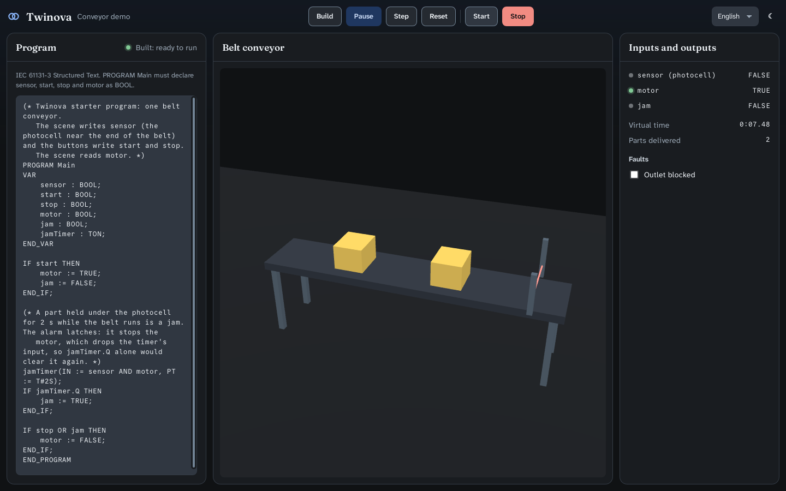
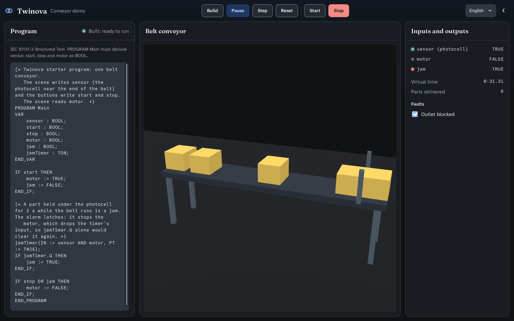
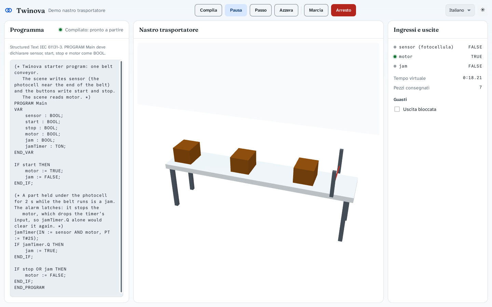

# Verification: Tauri shell with one conveyor scene (2026-11-07)

Spec: `docs/superpowers/specs/2026-11-07-tauri-shell-design.md`. Plan: `docs/superpowers/plans/2026-11-07-tauri-shell.md`.

Machine: cloud container, Ubuntu 24.04, 4 cores, Rust 1.99.0, Node 24.22.2, WebKitGTK 2.52.6. The display is Xvfb at
1440×900 with Mesa software rendering (`LIBGL_ALWAYS_SOFTWARE=1`, `WEBKIT_DISABLE_DMABUF_RENDERER=1`).

## Results

| Check | Command | Result |
|---|---|---|
| Backend tests | `cargo test` (app/src-tauri) | **18 passed, 0 failed** |
| Lint | `cargo clippy --all-targets -- -D warnings` | clean |
| Format | `cargo fmt --check` | clean, after one `cargo fmt` |
| Frontend types | `npm run check` (svelte-check, `--fail-on-warnings`) | 0 errors, 0 warnings |
| Frontend tests | `npm test` | **7 passed** |
| Frontend build | `npm run build` | built in 0.85 s |
| App build | `npx tauri build --debug --no-bundle` | built; 26 s after the dependencies were compiled once |

The backend tests include the spec's two 60 s scenarios on the default program:
- **outlet free**: the motor stays on, there is no jam, and at least 25 parts are delivered;
- **outlet blocked**: the jam trips 2 000 to 2 020 ms after the photocell is last covered, the motor stops, nothing is
  delivered.

## End to end (the real app, driven with xdotool)

1. **Launch.** The default program builds on start ("Built: ready to run").
2. **Run, then Start.** The motor goes TRUE, parts ride the belt, the photocell lights when covered and parts are
   delivered. 
3. **Outlet blocked.** The belt fills, `sensor` stays TRUE, then `jam` goes TRUE and `motor` goes FALSE.
   
4. **Real-time pacing**, from two timed crops of the virtual-time display:
   - 0:48.81 → 0:58.85, that is **10.04 s virtual**;
   - in **10.06 s** of wall time between the captures (`date +%s.%N`; each capture took 0.05 s).
5. **Italian and light theme.** Every text is translated and the 3D colours follow the theme's tokens.
   

## Found and fixed during verification

- **Scene model.** A new part entered with its *front* at 0, so its body sat before the belt and a blocked belt held
  11 parts. The capacity test caught it. Parts now enter with their rear edge at 0, the belt holds 10, and the spec is
  corrected and dated.
- **3D framing.** The first screenshot cut the belt in the narrow centre panel. The camera distance now comes from the
  viewport's aspect ratio (`framingDistance`, with a test).
- **Pacing.** The first look suggested virtual time ran fast: 21.7 s virtual in about 15 s wall. That estimate left out
  the time spent between the two screenshots. The timed measurement above shows the pacing is correct.

## What this does not prove

- Behaviour on Windows or macOS; only Linux was run.
- Pacing under CPU load. The engine reports lag (`lag_ms`), but no overload was provoked.
- Performance with many parts or many scenes.
- Determinism across machines, and the IEC conformance of truST's former VM beyond the cases tested.
- No coverage or mutation figures were measured in this slice. CLAUDE.md asks for them at Definition of Done, so
  setting up that tooling is the next task.
- The release binary was not built or bundled. The debug binary is 557 MB, because trust-runtime's `full` feature
  pulls the whole truST product.
