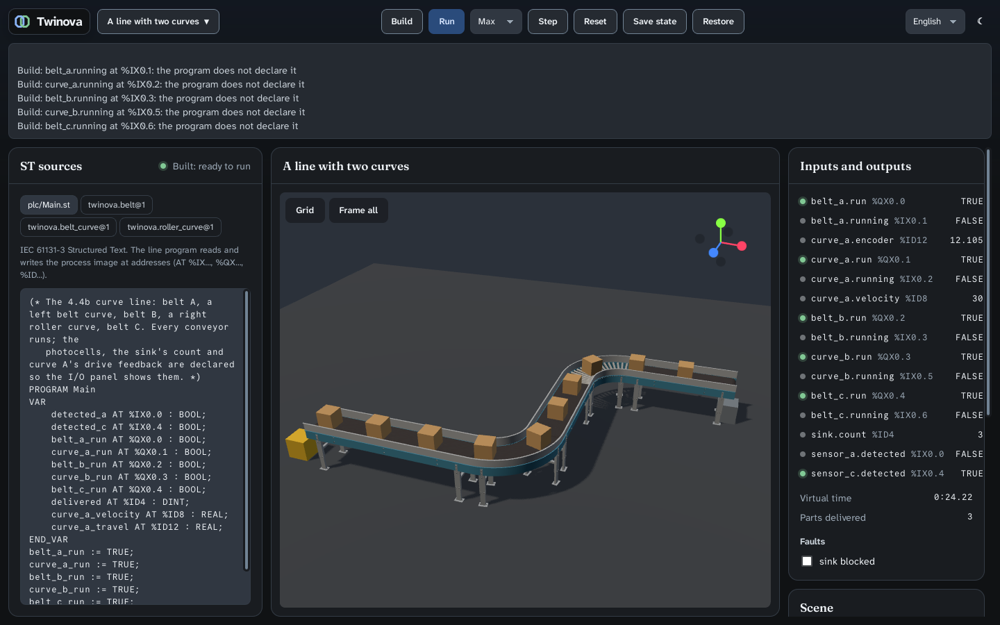

# Verification: curves, the belt's look, guards and incline, drive and tags (ROADMAP 4.4b, 2026-11-10)

Spec: `2026-11-10-curves-belt-options-design.md` (approved, amended in Tasks 2–5). Plan: `2026-11-10-curves-belt-options.md`.
Machine: the cloud container with 4 cores, Xvfb with Mesa llvmpipe, as in 4.4a. CI: PR #32.

## What runs

The new line fixture `curve_line`:

```
source → belt_a → curve_a (belt, 90° left) → belt_b → curve_b (rollers, 90° right) → belt_c → sink
```

- **Physics, translated from OIP at `1e7488c` (MIT) into Rust:**
  - `Coulomb` friction world-wide;
  - a curve is OIP's entry stub, chords of at most 10° and exit stub, with a rotating surface field ω × (p − c) read
    at each contact's world point;
  - guards: walls at the frame, 0.15 m above the surface, without friction;
  - incline is folded into the conveyor's pose;
  - a skewed roller drives along its normal.
- **The drive, re-expressed in ST** (`conveyorDrive.js`) in every conveyor block:
  - the ramp, landing on its millisecond;
  - `running`;
  - `velocity` (30 at `speed_at_30`);
  - an LREAL encoder and a pulse per `pulse_pitch`;
  - an optional `speed_ref` that falls back to `speed`.

  Unbound optional signals get private addresses in the field's own image.
- **The view, copied from OIP:** the straight belt, the curved belt, the curved roller conveyor and the shared floor
  stand. The belt's fabric scrolls by the conveyor's travel in the snapshot, and guards follow their parameters.



## The acceptance

| # | Criterion | Evidence | Result |
|---|---|---|---|
| 1 | A carton turns with a 90° curve, belt and rollers, left and right, and leaves square (yaw ≤ 3°, ≤ 5 mm off the centreline, tilt < 1°); a line straight → curve → straight runs in the app | `world_curve_tests.rs` `a_carton_turns_with_a_curve_and_leaves_square` (4 cases); `e2e/curve.mjs` Linux local 3/3, Windows on CI | ✅ |
| 2a | A skewed roller drifts a carton against its guard (lateral speed s·tan(skew) until contact) and the guard holds it | `a_skewed_roller_drifts_a_carton_to_its_guard_which_holds_it`: lateral within 3 %, throughput 0.5 ± 1 %, held at the guard to 3 mm; without the guard the carton leaves the bed | ✅ |
| 2b | A carton climbs a 10° incline at the belt's speed and does not slip back | `a_carton_climbs_an_incline_at_the_belts_speed`: 0.5 m/s ± 1 %, climb = travel × sin 10° to 2 mm; held on the stopped belt | ✅ |
| 2c | The product stays on a curve with guards at 1 m/s | `a_carton_stays_on_a_guarded_curve_at_one_metre_a_second` | ✅ |
| 3 | The drive: rated speed in `accel_time` and stop in `decel_time`, linearly; the encoder within one millisecond's travel; `velocity` 30 at `speed_at_30`; a bound `speed_ref` sets the speed | `field_drive_tests.rs`: 500 ms up and 200 ms down on their millisecond, 250 ms at half speed; encoder within 0.5 mm over 10 s; one pulse per inch; 30, 15 and 0; `speed_ref` 0.3, 0 (stopped with run on), −0.2. In the app, curve A reads 30 | ✅ |
| 4a | Breakaway on an incline (amended, user): holds 2° below atan(μ), slides 1° above, rollers and belts | `a_carton_breaks_away_on_an_incline_near_atan_mu` | ✅ |
| 4b | A skewed bed's throughput s and lateral speed s·tan(skew) | 2a, and `a_skewed_surface_keeps_its_throughput_and_drifts_by_the_tangent` exactly at 30° | ✅ |
| 5 | Determinism and gates | below | ✅ |

**Determinism.** The fingerprints, each equal in dev and release:

| Run | Fingerprint | Status |
|---|---|---|
| Two belts (Task 1, Coulomb) | `0x106e94227f30a7d7` | unchanged by Tasks 2–5 |
| Transfer line (Task 1, Coulomb) | `0x88a2f689560c76e4` | unchanged by Tasks 2–5 |
| Curve line | `0xfb7e9104c1a6c781` | new |

The windows-2022 job runs the same tests.

**Gates:**
- **Rust:** fmt, clippy `-D warnings`, `cargo test --workspace` (app 75, physics 55, project 48).
- **cargo mutants**, no survivor on the changed code:
  - the physics: 396 mutants, and the 47 rerun after two tests for 8 survivors;
  - the drive and the field: 64, with one equivalent excluded in `mutants.toml` with its reason;
  - the travel: 21;
  - the signal display: 2.
- **Frontend:**
  - svelte-check, oxlint, prettier, knip and jscpd, all clean;
  - vitest 80 tests; coverage 98.7 % statements, 88.1 % branches, 99.5 % functions, 99.6 % lines;
  - Stryker 85.1 % on `families.ts`, 96–100 % on `project.ts`, `meshes.ts`, `materials.ts`, `snapshot.ts` and
    `sources.ts`.
- **E2E, Linux local:** `run.mjs` 11/11, `project.mjs` 42/42, `line.mjs` 4/4, `curve.mjs` 3/3.

## Found by measuring (the spec records each)

- **Coulomb, not Rapier's default friction, turns a load with a curve** (87–89° against 5–15°). Task 1 re-pinned the
  fingerprints. It also showed that the demo's photocell sat on a held carton's back face to ±0.04 mm, so it moved
  to 2.75 m (user).
- **Rapier gives way 1–1.8° below atan(μ)**, an effective μ 5.6 % low, whatever the solver iterations, the warm start
  or the contact softness. The acceptance was amended (user).
- **truST `6405915`:**
  - an `AT %I*` cannot be configured at `%M`, so private addresses live in the field's image;
  - `DWORD_TO_REAL` keeps the bits, not the number;
  - a comment right before an assignment inside an `IF` breaks the C1 lowering.
- **The I/O panel printed a REAL as the integer of its bits** (curve A's velocity read 1106247680): fixed, a REAL
  reads as its number.
- **The drive costs a third of the field's time.** In release on the transfer line, per simulated ms:
  - the drive as first written: 64–71 µs;
  - a bare run-to-speed body: 43–45 µs;
  - physics alone: 18 µs;
  - the guards: 2–3 µs.

  Skipping the ramp at its target brought the drive to 57.5 µs with the same result every millisecond. The rest is the
  velocity, the encoder and the pulse.

## Soak of the release build

`xvfb-run node e2e/soak.mjs 45 <fixture>`.

| Phase | Transfer line: twinova CPU, RSS | Curve line: twinova CPU, RSS | Transfer line in 4.4a |
|---|---|---|---|
| Idle | 0.0 %, 176 MB | 0.0 %, 176 MB | 0.0 %, 175 MB |
| Run ×1 | 11.6 %, 177 MB | 16.0 %, 177 MB | 10.7 %, 176 MB |
| As fast as possible | 35.8 %, 177 MB | 35.5 %, 177 MB | 42.6 %, 176 MB |
| Paused | 0.0 %, 177 MB | 0.0 %, 177 MB | 0.0 %, 176 MB |

- **Memory is flat** in every phase. The web process holds about 510–530 MB, 15–30 MB more than in 4.4a, for OIP's
  belt meshes.
- **As fast as possible runs the transfer line at 4.1× real time** (184.2 s in 45 s) against 6.9× in 4.4a. The
  difference is the drive in ST (above) and Coulomb. The curve line runs at 2.7× (123 s in 45 s). ×1 keeps up on both.

## What this does not prove

- **Other carton sizes, products other than the carton, pallets** (4.4d).
- **A curve fed by a roller conveyor, or chained curves without a straight between them.**
- **Spurs, merges, multi-segment belts, guard openings and sensor holes in guards,** which OIP has and Twinova has no
  family for.
- **Why Rapier's effective μ is low.**
- **A skewed bed's look:** it is drawn square.
- **A PLC that drives `speed_ref`, the encoder or the pulse in the app:** the curve line binds only the velocity and
  the encoder, read by the I/O panel; the rest is proved in the field's tests.
