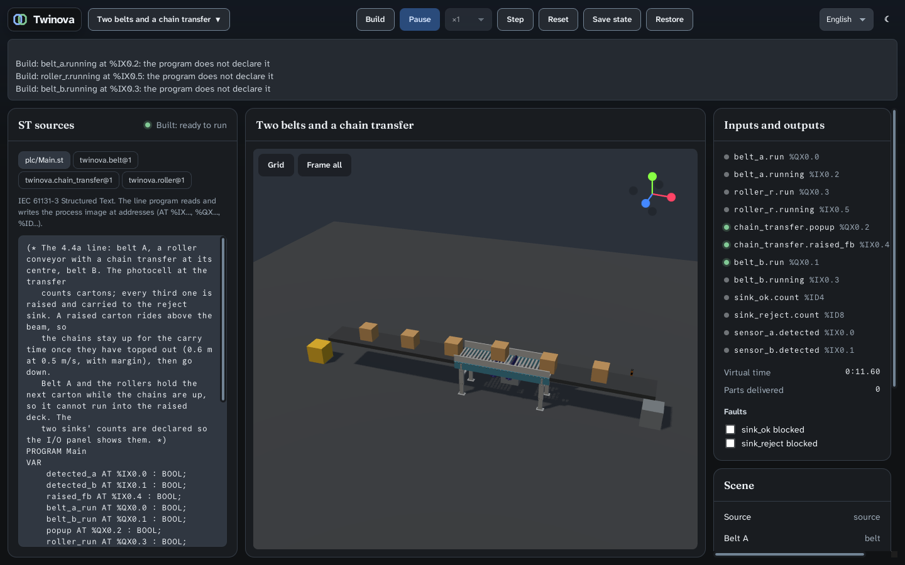

# Verification: roller conveyor, chain transfer and the first complete line (ROADMAP 4.4a, 2026-11-10)

Spec: `2026-11-10-diverter-line-design.md` (approved, amended while implementing). Plan: `2026-11-10-diverter-line.md`.
Machine: the cloud container with 4 cores, and Xvfb with Mesa llvmpipe, as in 4.3. CI: PR #28.

## What runs

The line fixture `two_belts_diverter`, as the spec draws it:

```
source → belt_a → roller_r (with chain_transfer at its centre) → belt_b → sink_ok
                                       └→ side exit → sink_reject
```

- **Copied from OIP at `1e7488c` (MIT), TypeScript:** the geometry builder and the roller conveyor, chain transfer and
  photo eye generators. Two textures and the materials' values. The notices are in `THIRD_PARTY_NOTICES.md`.
- **Translated from OIP into Rust:** the surface velocity per contact; the chain transfer as a kinematic deck fitted
  3 cm under its roller host, lifted 0.095 m and carrying sideways while raised.
- **Re-expressed in ST:** the chain transfer's `step()`, as `ChainTransferBehaviour`. Its stroke counts whole
  milliseconds.



## The acceptance

| # | Criterion | Evidence | Result |
|---|---|---|---|
| 1 | The line runs in the app: both sinks count in the program's ratio; the I/O panel shows `popup` and `raised_fb`; the deck is drawn at its lift | `e2e/line.mjs`, Linux local 4/4; Windows on CI (PR #28) | ✅ |
| 2 | No carton lost or duplicated: created = delivered + on the line, every millisecond, also with `sink_ok` blocked (finite queue) | `line_tests.rs` `no_carton_is_lost_or_duplicated_and_a_blocked_normal_sink_holds_a_finite_queue` (60 s); `world_transfer_tests.rs` with every third carton diverted (60 s) | ✅ |
| 3 | Routing follows the command | `every_third_carton_is_raised_and_carried_to_the_reject_sink`: 9 cartons give 6 to `sink_ok` and 3 to `sink_reject` | ✅ |
| 4 | Determinism | Step, ×1 and as fast as possible reach the same state at 15 s (`engine_tests.rs`). The fingerprint of a line with a transfer diverting, `0x417f321f68a7ccb0`, is equal in dev and release, and on windows-2022 (`project-windows` job) | ✅ |
| 5 | Fidelity, after OIP's `physicsFidelity.test.ts` | rollers carry at 0.5 m/s ± 1 %; the lift throws a carton within 4 mm of v²/2g (0.63 m/s → 20 mm, as OIP's comment says); the transfer carries out square, yaw < 1° | ✅ |
| 6 | Provenance | each copied or translated file names its OIP source and commit; both `THIRD_PARTY_NOTICES.md` | ✅ |
| 7 | Gates | below | ✅ |

**Gates:**
- **Rust:** fmt, clippy `-D warnings`, `cargo test --workspace` (app 67, physics 32, project 46).
- **cargo mutants:** 0 survivors on the changed code:
  - physics: 211 mutants;
  - the line and the world's exits: 96;
  - the snapshot's lifts: 12.
- **Frontend:**
  - svelte-check, oxlint, prettier, i18n, knip and jscpd, the copied code included;
  - vitest 67 tests, coverage 97.5 % statements, 86.2 % branches, 98.2 % functions, 98.1 % lines;
  - Stryker 99.2 % on `meshes.ts`, `families.ts`, `materials.ts`, `project.ts`, `snapshot.ts` and `sources.ts`.
- **E2E, Linux local:** `run.mjs` 11/11, `project.mjs` 42/42, `line.mjs` 4/4.

## Found by measuring, and fixed (the spec records each)

- **A raised carton rides above the photocell's beam.** The beam is 5 cm above the rollers; the raised carton sits
  6.5 cm above them. Lowering on a clear beam dropped the carton back mid-carry, so the program keeps the chains up
  for a 1.5 s carry time.
- **At 2 s spacing, the next carton runs into the raised deck.** The program holds belt A and the rollers while the
  chains are up.
- **With the side exit spanning the deck only, a queue over a raised transfer spilled half-carried cartons onto the
  floor.** The exit now reaches half a carton past the deck, like a chute.
- **A chain transfer's ST ramp in REAL stopped one millisecond short of 1.0.** It now counts whole milliseconds.

## Soak of the release build on the line

`xvfb-run node e2e/soak.mjs 45 src-tauri/project/tests/fixtures/valid/two_belts_diverter`. The line has three
conveyors, four field blocks (two belts, the rollers, the transfer), a kinematic deck, and up to about a dozen cartons
on it.

| Phase | twinova CPU | RSS twinova | WebKitWebProcess CPU, RSS | The demo in 4.3a |
|---|---|---|---|---|
| Idle | 0.0 % | 175 → 174 MB | 0.0 %, 483 → 481 MB | 0.0 %, 168 MB |
| Run ×1 | 10.7 % | 176 MB | 274.5 %, 482 → 495 MB | 7.0 %, 169 MB |
| As fast as possible | 42.6 % | 176 MB | 241.0 %, 496 → 498 MB | 44.7 %, 169 MB |
| Paused | 0.0 % | 176 → 175 MB | 0.5 %, 498 → 494 MB | 0.0 %, 169 MB |

- **Memory is flat** in every phase. The web process holds about 15 MB more than with the demo's stand-in shapes,
  for OIP's meshes.
- **As fast as possible: 310.5 s of virtual time in 45 s, 6.9× real time,** against 21.9× for the demo. This line is
  not profiled. Where its extra cost lies (the field's four blocks, the controller, the physics with more cartons in
  contact) is not measured here.

## What this does not prove

- **Building the line by hand.** That is the editor, 4.5.
- **The belt's look, curves, and the roller options** (skew, incline, guards, drive ramps). They come in 4.4b.
- **A transfer fitted in a roller conveyor narrower or wider than its lanes,** or two transfers on one host in the
  app. The second case is tested in the physics only.
- **Products other than the 0.3 m carton,** or a packed row lifted at once.
- **OIP's look exactly.** Its finishes are a triplanar shader that is not ported, and the photo eye sits 3 cm lower
  than OIP's, so its lens is on Twinova's beam.
- **A real PLC** (M5).
