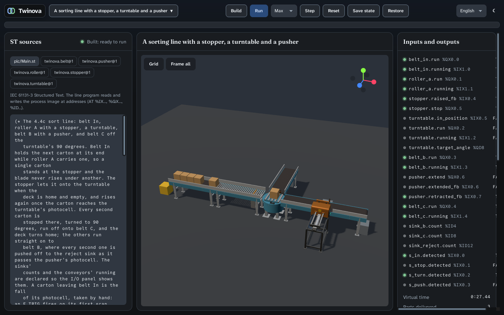

# Verification: stopper, pusher and turntable (ROADMAP 4.4c, 2026-11-11)

Spec: `2026-11-11-stopper-pusher-turntable-design.md` (approved, amended in Tasks 1–3). Plan:
`2026-11-11-stopper-pusher-turntable.md`. Machine: the cloud container with 4 cores, Xvfb with Mesa llvmpipe, as in
4.4a and 4.4b. CI: the 4.4c pull request.

## What runs

The new line fixture `sort_line`:

```
source → belt_in → roller_a (stopper) → turntable ─(0°)→ belt_b (pusher → reject) → sink_b
                                                  └(90°)→ belt_c → sink_c
```

- **Physics, translated from OIP at `1e7488c` (MIT) into Rust:**
  - The stopper's blade and the pusher's paddle are OIP's colliders on kinematic position-based bodies, posed every
    millisecond from their ST blocks, as the chain transfer's deck is. They pass through the fixed decks and guards and
    meet only the cartons.
  - The turntable is a conveyor whose deck is OIP's static cross. While the deck turns, its lane is the curves'
    rotating field at the deck's rate; settled, the lane runs along the deck's angle.
  - A pusher opens its own guard over 0.75 m, view and collider.
- **Logic, re-expressed in ST:**
  - the strokes of the stopper and the pusher, with Twinova's end-of-stroke feedback;
  - OIP's slew for the turntable, with the conveyor drive for its lane.
- **View, copied from OIP:** the three generators, procedural all three, and OIP's fillet. The moving links are posed
  from the snapshot, and the pusher's lamps light as OIP's do.



## The acceptance

| # | Criterion | Evidence | Result |
|---|---|---|---|
| 1 | Stopper at 0.5 m/s with OIP's defaults: three cartons stand against the blade, the front within 1 mm, at rest, tilted < 2°; lowered, the front runs at the host's speed within 0.22 s (amended); `raised_fb` follows the stroke | `world_stopper_tests.rs`: front −0.3 mm, queue spaced 0.3 m, max tilt 1.55°, at speed after 209 ms; `field_devices_tests.rs`: 150 cycles to the top, `raised_fb` only there | ✅ |
| 2 | Pusher at 0.25 s: a carton passing at 0.5 m/s goes onto a perpendicular takeaway, upright (< 1° at rest, < 5° max) and square (≤ 3°); `extended_fb` and `retracted_fb` follow the stroke | `world_pusher_tests.rs`: carried away at 0.5 m/s, square and upright; the side exit's bounds; `field_devices_tests.rs`: 250 cycles out and back, each feedback only at its end | ✅ |
| 3 | Turntable: a carton turned 90° at 20°/s leaves its place by ≤ 2 mm and its yaw by ≤ 0.5°, and runs off along the new heading; 90° in 4 983 ms (amended); `in_position` only when settled; enable off stops it within 3° | `world_turntable_tests.rs`: turned, then into belt C's sink; `field_devices_tests.rs`: 4 983 ms, a peak of 20°/s, stop within 3° and resume, a reversal through 0, the short way through 180°, the start angle | ✅ |
| 4 | `sort_line` in the app on Linux and Windows: singulated at the stopper, every second carton turned, every second straight one pushed; none lost; the same under Step, ×1 and as fast as possible | `line_devices_tests.rs`: 60 s with conservation every millisecond, no carton off the line, the routing within one carton in flight, the run modes equal; `e2e/sort.mjs` Linux 3/3, Windows on CI | ✅ |
| 5 | Gates | below | ✅ |

**Determinism.** The existing fingerprints are unchanged: two belts `0x2674dda1319b763a`, transfer line
`0x2c224abfa5e90d6c`, curve line `0xaba061e54b1dfbe2`. The turntable cell is pinned at `0x1109870f76d5c9c8`, equal in
dev and release. The windows-2022 job runs the physics tests.

**Gates:**
- **Rust:** fmt, clippy `-D warnings`, `cargo test --workspace` (app 99, physics 72, project 48).
- **cargo mutants:**
  - 316 mutants on the changed physics and 32 on the changed field, line and engine. 16 survived, each a missing test
    or an equivalent comparison (the commit lists them).
  - After the tests and the restructured comparison, the 93 mutants of those functions are all caught or time out.
- **Frontend:**
  - svelte-check, oxlint, prettier, i18n, knip and jscpd, all clean; the 600-line cap holds;
  - vitest 142 tests; coverage 99.0 % statements, 90.1 % branches, 99.7 % functions, 99.7 % lines;
  - Stryker: `families.ts` 83.0 %, `openings.ts` 91.3 %, `snapshot.ts` and `materials.ts` 100 %.
- **E2E, Linux local:** `run.mjs` 11/11, `project.mjs` 42/42, `line.mjs` 4/4, `curve.mjs` 3/3, `sort.mjs` 3/3.

## Found by measuring (the spec records each)

- **OIP's grip on the turntable patches Jolt.** Rapier's Coulomb field alone turns a carton 90° within 0.01° and
  0.7 mm, even at 180°/s, so neither the grip nor the deck body is translated.
- **The stopper's release.** It takes 209 ms, not the probe's 157 ms: the probe lowered the blade 2.7 times OIP's
  stroke.
- **OIP's friction is combined by geometric mean.** The blade and the paddle grip a carton at √(0.6 × 0.5) = 0.548.
- **A wall at a pusher's side crushed the carton against the paddle,** so that side has none.
- **OIP's profile, stepped every millisecond,** turns 90° at 20°/s in 4 983 ms, not 5.0 s.
- **OIP's default 4 cm blade is low for a 0.3 m carton above 0.5 m/s:** it tilts 6.6° at 1 m/s and 30° at 2 m/s. OIP's
  own demo raises 0.15.
- **The fixture's program:**
  - an IEC F_TRIG fires on its first scan with its input clear, which held the first carton for good; the edge is
    taken by hand;
  - a block local named like a parameter is bound to it by the field (the pusher's `stroke`), so it is `span`.

## Timing and soak of the release build

**A simulated millisecond, in µs** (`Line::step_ms` over 30 s after 5 s, three rounds, measured the same hour):

| | Transfer line | Curve line | Sort line |
|---|---|---|---|
| main (`c62fcf7`) | 43.2–45.9 | 70.3–72.1 | — |
| 4.4c | 43.6–44.7 | 67.6–70.9 | 82.6–84.5 |

4.4c costs the existing lines nothing. The machine is slower today than when 4.4b2 measured 35 µs on the transfer line,
which is why the soak's as-fast-as-possible figure for that line is lower than 4.4b2's.

**Soak** (`xvfb-run node e2e/soak.mjs 45 <fixture>`), the engine process:

| Phase | Sort line | Transfer line |
|---|---|---|
| Idle | 0.0 %, 176 MB | 0.0 %, 176 MB |
| Run ×1 | 14.4 %, 177 MB | 9.4 %, 176 MB |
| As fast as possible | 72.3 %, 177 MB | 72.3 %, 176 MB |
| Paused | 0.0 %, 177 MB | 0.1 %, 175 MB |
| **Virtual time after 45 s as fast as possible** (from 46 s) | **356 s: 6.9× real time** | **614 s: 12.6× real time** |

Memory is flat in every phase. The web process holds 550 MB on the sort line, about 35 MB more than on the transfer
line, for the three new models.

## What this does not prove

- **Other cartons, pallets, a row of cartons on a turntable or against a pusher** (4.4d brings product attributes).
- **A turntable chained to another, or fed at an angle other than its four ends.**
- **A stopper on a belt, a pusher on a curve:** neither fits, as in OIP.
- **Pneumatics:** the strokes are OIP's linear slews, with no cushioning or air pressure.
- **A carton pushed at OIP's speed with nothing beside the conveyor** falls to the floor, as in OIP; no test measures
  where.
- **The turntable's look at stands under about 0.48 m,** where OIP's slew drive pokes through the deck (copied as it
  is). The fixtures use 0.8 m.
